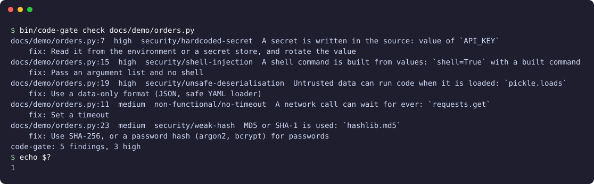

# code-gate

code-gate is a static code checker for AI-written code: a command line, an MCP server and a Claude Code plugin that find security holes, bad algorithms and missing timeouts or error handling in the code a model writes, before it is called done.



It checks Python, TypeScript/JavaScript, Java and Go. Standard library only: it needs Python 3.9 or newer and
nothing else.

The capture is real output on a small file with planted mistakes, `docs/demo/orders.py` (the key in it is made
up). The same run as text:

```
$ bin/code-gate check docs/demo/orders.py
docs/demo/orders.py:7  high  security/hardcoded-secret  A secret is written in the source: value of `API_KEY`
    fix: Read it from the environment or a secret store, and rotate the value
docs/demo/orders.py:15  high  security/shell-injection  A shell command is built from values: `shell=True` with a built command
    fix: Pass an argument list and no shell
docs/demo/orders.py:19  high  security/unsafe-deserialisation  Untrusted data can run code when it is loaded: `pickle.loads`
    fix: Use a data-only format (JSON, safe YAML loader)
docs/demo/orders.py:11  medium  non-functional/no-timeout  A network call can wait for ever: `requests.get`
    fix: Set a timeout
docs/demo/orders.py:23  medium  security/weak-hash  MD5 or SHA-1 is used: `hashlib.md5`
    fix: Use SHA-256, or a password hash (argon2, bcrypt) for passwords
code-gate: 5 findings, 3 high
$ echo $?
1
```

Exit code `1` means a finding at or above `--fail-on` (default `high`). This is the fast static pass; no model
or network is used.

## Quick start

The package is not on PyPI yet (`code-gate-llm` returns 404 there), so run it from a clone. This needs only Python
3.9 or newer:

```bash
git clone https://github.com/YauhenBichel/code-gate && cd code-gate
python3 bin/code-gate check docs/demo/orders.py     # the output above
python3 bin/code-gate --version                     # code-gate 0.1.0
```

To get a `code-gate` command on your path, install from the clone (works today):

```bash
pip install .            # or: uv tool install .   or: pipx install .
code-gate check src/
```

To use it inside Claude Code, add the plugin from the clone. It checks every file Claude edits and starts the MCP server:

```bash
claude plugin marketplace add ./code-gate
claude plugin install code-gate@code-gate
```

## When to use it, and when not

Use it as a cheap first gate on code that a model wrote: it catches obvious mistakes in milliseconds and tells the
model what to fix. Do not use it as your only check. It does not follow data across functions or files, and it is
not a replacement for semgrep, a type checker or a human review (see Limits).

## What it does

1. **On every edit** (a `PostToolUse` hook on Edit and Write) it runs static checks on the file, in a few
   milliseconds. A `high` finding blocks: Claude is told what is wrong and must fix it. A `medium` finding is
   passed to Claude as a note. `low` findings are not shown by the hook.
2. **On request** (`/code-gate:review`, the MCP tools, or `--deep`) it also asks a local model for what static
   checks cannot see: a function doing several jobs, a wrong container, a worse complexity than needed.

## Command line

```bash
code-gate check src/              # static checks
code-gate check app.py --deep     # also ask the local model
code-gate check src/ --json --fail-on medium
code-gate rules                   # the 38 static rules
```

Exit code: `0` nothing at or above `--fail-on` (default `high`), `1` such a finding, `2` a path that does not
exist or a wrong option. From a checkout, `bin/code-gate` does the same without installing.

Files that are not regular files (pipes, devices), files larger than 400 KB and files in other languages are
skipped and listed as skipped. A file the parser cannot take is reported as not fully checked; the run goes on.

## MCP tools

| Tool | What it does | Read-only |
| --- | --- | --- |
| `review_files` | check files on disk (`paths`, optional `deep`) | yes: reads files, changes nothing |
| `review_code` | check a snippet up to 400 KB (`code`, `language` or `filename`, optional `deep`) | yes |
| `list_rules` | the static rules with category and severity | yes |

The plugin starts the server by itself. For any other MCP client, after `pip install .` from a clone (or, once
it is published, `pip install code-gate-llm`):

```bash
claude mcp add code-gate -- code-gate mcp
```

Without installing, point the client at the clone:

```bash
claude mcp add code-gate -- python3 /path/to/code-gate/bin/code-gate mcp
```

or, in `.mcp.json`, `.cursor/mcp.json` or the client's own server list:

```json
{
  "mcpServers": {
    "code-gate": { "command": "code-gate", "args": ["mcp"] }
  }
}
```

The server speaks MCP over stdio and reads files only on the machine it runs on. The hook is specific to
Claude Code. Tested with Claude Code only.

## The local model

The deep pass is off unless you ask for it. It posts the file to an OpenAI-compatible server on your own
machine. The defaults are those of llm-harness, a local model router: the address
`http://127.0.0.1:11500/v1/chat/completions` and the model name `llm-harness/local-only`. That name is a lock:
the harness never passes such a request to a cloud model. If the running harness is too old to list
`local-only`, code-gate runs `llm-harness local --file <prompt>` instead. With no such server and no such
command, the static findings are returned with a note that the model was not used.

- Lines where a secret was found, and lines longer than 4,000 characters, are removed before the code is sent.
- The answer is used only when the server says, in the `x-harness-backend: local` header, that the local model
  served it. Any other answer is thrown away. A server that does not send this header (Ollama, llama.cpp,
  LM Studio, vLLM) needs `"allow_remote": true` in **your own** settings file; you then vouch for where it runs.
- Every model finding is checked: known category, known severity, a line that exists. The rest is dropped.
  Control characters and hidden Unicode marks are removed from what the model wrote before it is shown.
- If the model is down, slow or cut off, the static findings are returned with a note. Nothing fails.

Model findings are marked `model`. They are a second opinion and can be wrong.

## Settings

There are two files, and they are not trusted the same.

**Your own file** may set everything. It is `~/.config/code-gate/config.json` (or under `$XDG_CONFIG_HOME`),
or the file named by the `CODE_GATE_CONFIG` environment variable:

```json
{
  "model": {
    "url": "http://127.0.0.1:11434/v1/chat/completions",
    "model": "qwen2.5-coder",
    "command": ["my-model-cli", "--file"],
    "allow_remote": true
  }
}
```

**A project's file** is `.code-gate.json` in the folder of the file or any folder above it. It comes with the
repository, so it is written by whoever wrote the repository. It can tune the checks:

```json
{
  "disable": ["print-instead-of-log"],
  "limits": {"function_lines": 80},
  "hook": {"block_on": "high", "report_from": "medium"},
  "model": {"enabled": true, "timeout": 300, "max_lines": 400, "max_findings": 8}
}
```

It can **not** set `model.command`, `model.url`, `model.model` or `allow_remote`: a repository you cloned must
not choose a program to run on your machine or a server to send your code to. Such keys are ignored and a
warning names them. A settings file with a wrong type or an unknown key is also a warning, not a failure: the
bad value is left at its default and the checks run.

`block_on` can be `never`. To silence one line, put `code-gate: ignore[rule]` in a comment on it or on the line above.

## Limits

- Python is read with `ast`. The other three languages are read with brace and line heuristics, not a parser, so
  they miss more and can be wrong on unusual formatting. Java and Go have the fewest rules: for example
  `no-timeout` sees `requests`, `httpx` and `urllib.request.urlopen` in Python, `fetch` and `axios` in
  TypeScript/JavaScript and the default HTTP client in Go, and nothing in Java.
- A file with a line longer than 10,000 characters (minified or generated code) gets only the line checks; the
  result says so.
- Python code that uses grammar newer than the Python running code-gate cannot be parsed. It is reported as a
  `low` `newer-syntax` finding, which never blocks; run code-gate with a newer Python to check such a file.
- `empty-function` (medium) is a function whose body is only `pass` or `...`. It becomes `placeholder` (high)
  only when the code itself says it is unfinished (`TODO`, `FIXME`, "not implemented"). Abstract methods,
  protocols, overloads and documented hooks are not reported.
- `hardcoded-secret` looks at the value as well as the name, so a short or word-like secret can be missed.
- The hook checks the whole file, so an old problem in a file blocks a new edit to it until it is fixed or ignored.
- It does not follow data across functions or files. It is a gate for obvious mistakes, not a replacement for
  semgrep, a type checker or a human review.

## FAQ

### How do I check code that Claude or another model wrote?

Run `code-gate check <file or folder>`, or install the Claude Code plugin and let the hook check each edit. A
`high` finding blocks the edit and tells the model what to fix.

### Does it send my code anywhere?

No. The static pass runs on your machine and makes no network calls. Only the optional deep pass (`--deep`)
posts a file, to a model server on your own machine, with secrets and very long lines removed first. See The local model.

### Do I need a GPU or an API key?

No. The static checks need neither. The deep pass needs an OpenAI-compatible server you run yourself, and is off by default.

### How do I silence a false alarm?

Put `code-gate: ignore[rule]` in a comment on that line or the line above, or list the rule under `disable` in a
project `.code-gate.json`.

### How is it different from semgrep or bandit?

Those are broader and have large community rule sets. code-gate is small (38 rules, no dependencies), covers
design and non-functional mistakes as well as security, and is built to talk to a model: it runs as a hook on every
edit and as an MCP server. It reads Python with `ast` and the other languages with heuristics, so it misses more
than a full analyser. Use it beside them, not instead.

### Which languages does it support?

Python, TypeScript/JavaScript, Java and Go. Java and Go have the fewest rules.

## Development

```bash
python3 -m unittest discover -s tests     # no dependencies; Python 3.9 to 3.14
python3 bin/code-gate check src           # code-gate on its own source
```

Changes are listed in [CHANGELOG.md](https://github.com/YauhenBichel/code-gate/blob/main/CHANGELOG.md).
Licence: MIT, see [LICENSE](https://github.com/YauhenBichel/code-gate/blob/main/LICENSE).
